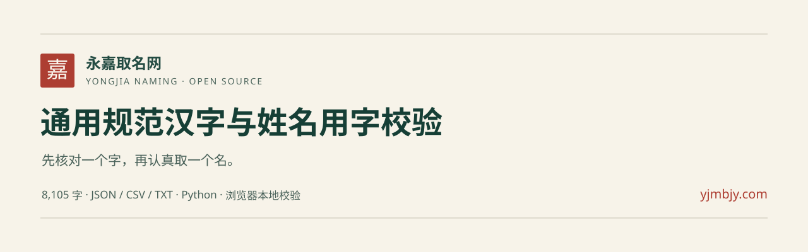

# Standard Chinese Characters & Name Character Checks



[中文](README.md) · [Yongjia Naming / 永嘉取名网](https://www.yjmbjy.com/) · [Download data](data/README.md)

[Releases & packaged downloads](https://github.com/sud423/chinese-standard-naming-characters/releases/latest)

**Maintained by Yongjia Naming (永嘉取名网).** An offline dataset and toolkit for
checking whether each character in Chinese names or text belongs to the 2013
*Table of General Standard Chinese Characters* (通用规范汉字表).

Useful for Chinese name forms, editorial checks, text processing and character
applications. Returns the table index, level, original source reference and
Unicode code point. There are no runtime third-party dependencies or API keys.

## Included

- **8,105 entries**: level 1 (3,500), level 2 (3,000), level 3 (1,605).
- [JSON](yongjia_naming/data/characters.json), [CSV](data/characters.csv),
  [one-character-per-line TXT](data/characters.txt), and a
  [versioned manifest](yongjia_naming/data/manifest.json).
- Python 3.10+ API and CLI, including UTF-8 batch input and JSON Lines output.
- A [local browser demo](examples/index.html) without tracking or input uploads.
- A deterministic conversion script, source checksums, tests and CI.

Machine-readable data is derived from the `kTGH` property in the official
**Unicode 17.0.0 Unihan** snapshot. The underlying 2013 table was developed by
China's Ministry of Education and State Language Commission; Yongjia Naming
maintains this conversion and toolkit. See [provenance](DATA_SOURCES.md) and
[attribution](NOTICE.md). The pinned snapshot is for reproducibility, not a claim
to track the latest Unicode release.

## Quick start

```sh
git clone https://github.com/sud423/chinese-standard-naming-characters.git
cd chinese-standard-naming-characters
python -m yongjia_naming lookup 一 --json
python -m yongjia_naming check 李明 --json
```

```json
{"character": "一", "codepoint": "U+4E00", "index": 1, "level": 1, "source_ref": "2013:1"}
```

To use the package outside the repository, run `python -m pip install .` first.
The installed command is `yongjia-naming`. This package has not been published to
PyPI.

```python
from yongjia_naming import check_name, characters, lookup

assert lookup("一").index == 1
assert len(characters(level=3)) == 1605
report = check_name("李明")
print(report.all_in_table)
print(report.to_dict())
```

`lookup()` accepts one Unicode scalar and returns `None` when it is absent.
Empty input, multiple scalars and unpaired surrogates raise errors.
`check_name()` accepts nonempty text, checks each scalar, and does not parse
surnames or given names.

For batch checks, create a UTF-8 file with one input per line:

```sh
python -m yongjia_naming check --file names.txt --json
```

Empty lines are skipped; spaces are preserved. Exit codes: **0** all characters
are in the table; **1** at least one is absent; **2** invalid input or an error.
`lookup --json` prints `null` and returns 1 for an absent scalar.

## Browser demo

From the repository root:

```sh
python -m http.server 8000 --bind 127.0.0.1
```

Visit [http://127.0.0.1:8000/examples/](http://127.0.0.1:8000/examples/).
Opening the HTML directly via `file:` is unsupported. The demo fetches the bundled
JSON once and processes input locally. After loading the data, checks work
offline. Website links lead to the maintainer's public site.

## What the result means

Membership is **not** a name quality score, a pronunciation or meaning check, or a
registration decision. Absence does not prove that a character is incorrect.
Input is preserved without normalization, whitespace removal or automatic
traditional/simplified conversion. Variation selectors are checked separately.
Supplementary-plane characters such as `𣲗` (`U+23C97`) are handled as one scalar.

The upstream `kTGH` property is provisional. This release verifies completeness,
indices, code points, checksums and artifact consistency; it does not claim a
manual comparison of every glyph with the official PDF.

## About Yongjia Naming

Yongjia Naming provides tools and articles about Chinese names, character
meanings, pronunciation, combinations and everyday use. This project opens a
small, inspectable building block for developers and editors.

- [Character reference and articles](https://www.yjmbjy.com/characters)
- [Chinese baby naming tool](https://www.yjmbjy.com/baby-naming)
- [Naming knowledge and methods](https://www.yjmbjy.com/knowledge)

## Development & licensing

```sh
python -m unittest discover -s tests -v
node --test tests/test_browser.mjs
```

Node.js 18+ is only needed for browser-module tests. See [design](DESIGN.md),
[contributing](CONTRIBUTING.md) and [changelog](CHANGELOG.md).

Original code, documentation and artwork: [MIT](LICENSE). Derived Unicode data:
[Unicode License V3](yongjia_naming/data/LICENSE-UNICODE.txt). Preserve both notices
when redistributing. Attribution does not imply endorsement by Unicode or the
organizations responsible for the official table.
