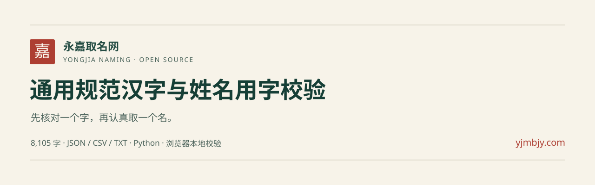

# 通用规范汉字与姓名用字校验



[English](README.en.md) · [永嘉取名网](https://www.yjmbjy.com/) · [数据下载](data/README.md) · [来源与许可](DATA_SOURCES.md)

[发行版本与打包下载](https://github.com/sud423/chinese-standard-naming-characters/releases/latest) · [姓名表单接入说明](docs/name-input-checks.md)

**由永嘉取名网（Yongjia Naming）开源维护。** 提供 2013 版《通用规范汉字表》8,105 字的结构化数据与离线校验工具，供中文姓名表单、内容编辑、数据清洗与汉字应用使用。

先回答一个具体问题：**输入的每个字，是否收录于这份规范字表？** 返回字表级别、序号和 Unicode 码点，不把“在表”转换为名字分数。

## 可以直接用什么

| 需要 | 本仓库提供 |
| --- | --- |
| 下载规范字清单 | [JSON](yongjia_naming/data/characters.json) / [CSV](data/characters.csv) / [TXT](data/characters.txt)，UTF-8 编码、完整序号 |
| 接入程序 | Python 3.10+ API，运行时无第三方依赖，数据随包提供 |
| 核对一批文本 | 单字查询、逐字校验、UTF-8 文件批量校验，支持 JSON Lines 输出 |
| 试用网页交互 | [浏览器本地演示](examples/index.html)，输入不上传，无统计脚本 |
| 追溯与复现 | 固定 Unihan 快照、原始引用、SHA-256、[转换脚本](scripts/build_data.py)与测试 |

一级 3,500 字、二级 3,000 字、三级 1,605 字。机器可读数据来自 **Unicode 17.0.0 Unihan 的 `kTGH` 映射**；字表由教育部、国家语言文字工作委员会组织制定。永嘉取名网负责本项目的数据转换、工具与维护，详见[来源说明](DATA_SOURCES.md)。

## 30 秒开始

```sh
git clone https://github.com/sud423/chinese-standard-naming-characters.git
cd chinese-standard-naming-characters
python -m yongjia_naming lookup 一 --json
python -m yongjia_naming check 李明 --json
```

单字查询返回：

```json
{"character": "一", "codepoint": "U+4E00", "index": 1, "level": 1, "source_ref": "2013:1"}
```

需要从其他目录使用命令或导入包时，先在仓库根目录安装：

```sh
python -m pip install .
yongjia-naming check 李明
```

这里的安装来源是当前仓库，尚未发布至 PyPI。

### Python API

```python
from yongjia_naming import check_name, characters, lookup

print(lookup("一").level)                 # 1
print(len(characters(level=3)))           # 1605
report = check_name("李明")
print(report.all_in_table)                # True
print(report.to_dict())                   # 每字结果与来源记录
```

`lookup()` 接受一个 Unicode 码点，表外字符返回 `None`；空字符串、多字输入或不完整代理项报错。`check_name()` 逐字检查非空字符串，不拆分姓与名。

### 批量校验

准备 UTF-8 编码 `names.txt`，每行一条；命令跳过空行、保留空格：

```sh
python -m yongjia_naming check --file names.txt --json
```

`--json` 每条输入输出一行 JSON。退出码 `0` 表示全部字符在表，`1` 表示存在表外字符，`2` 表示参数、输入或读取错误。`lookup --json` 对表外字符输出 `null` 并返回 `1`。

### 浏览器示例

在仓库根目录运行以下标准库命令后，打开 [http://127.0.0.1:8000/examples/](http://127.0.0.1:8000/examples/)：

```sh
python -m http.server 8000 --bind 127.0.0.1
```

请通过本地 HTTP 服务访问，而非双击 HTML 文件。页面读取仓库内的 JSON；姓名只在当前浏览器处理。首次载入数据后可断网核对，点击官网链接时才离开示例。

## 结果怎么理解

- **在表 ≠ 适合起名。** 级别表示字表分组，不是好坏、吉凶或推荐度；本工具不判断是否能办理姓名登记。
- **不在表 ≠ 错字。** 繁体字、其他汉字、标点或字母可能未匹配；结果只针对 2013 版字表。
- **保留原始输入。** 不静默转换繁简字、不删除空白、不做 Unicode 归一化。异体选择符也单独检查。
- **正确处理补充平面。** 例如 `𣲗` 为一个码点 `U+23C97`；不能用 JavaScript 的字符串长度代替汉字数。
- **不猜读音和字义。** 当前版本不提供未经核验的姓氏读音、字义或典故。

## 继续了解名字：永嘉取名网

永嘉取名网围绕名字的读音、字义、搭配与使用场景，提供工具与阅读资料。本项目开放“先核对用字”这一小块基础能力，方便开发者复用，也让读者能追溯判断依据。

- [起名用字](https://www.yjmbjy.com/characters)：继续查阅用字资料与搭配文章。
- [宝宝起名工具](https://www.yjmbjy.com/baby-naming)：按自己的需要比较名字候选。
- [起名知识](https://www.yjmbjy.com/knowledge)：阅读取名方法、读音字形与文化解释。

## 开发与贡献

```sh
python -m unittest discover -s tests -v
node --test tests/test_browser.mjs
```

Node.js 18+ 仅用于验证浏览器示例，不是 Python 工具的运行依赖。数据复现见 [DATA_SOURCES.md](DATA_SOURCES.md)，技术边界见 [DESIGN.md](DESIGN.md)，纠错方式见 [CONTRIBUTING.md](CONTRIBUTING.md)，版本变化见 [CHANGELOG.md](CHANGELOG.md)。

接入前可读：[中文姓名表单的 Unicode 边界与字表检查](docs/name-input-checks.md)，包含基本区正则、补充平面、空白和异体选择符的处理示例。

## 许可

原创代码、文档与视觉素材使用 [MIT](LICENSE)；派生 Unicode 数据单独遵循 [Unicode License V3](yongjia_naming/data/LICENSE-UNICODE.txt)。再分发时保留各自的许可和来源说明。完整归属与商标说明见 [NOTICE.md](NOTICE.md)。
