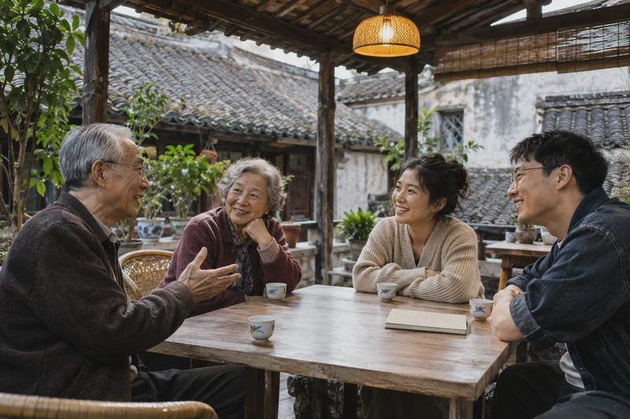

# 长辈与父母起名僵持，先谈哪些条件

取名方法 · 官网文章导读

家谱、纪念与日常叫法，常是家庭选名分歧背后的不同考虑。原文介绍如何把这些考虑整理成共同条件，再用相同方式比较候选，适合正在和长辈商量名字的家庭阅读。

[前往永嘉取名网阅读全文 →](https://www.yjmbjy.com/article/couple-elders-naming-filter-sequence)

[返回导读目录](README.md) · [规范字校验技术文章](../docs/README.md)
